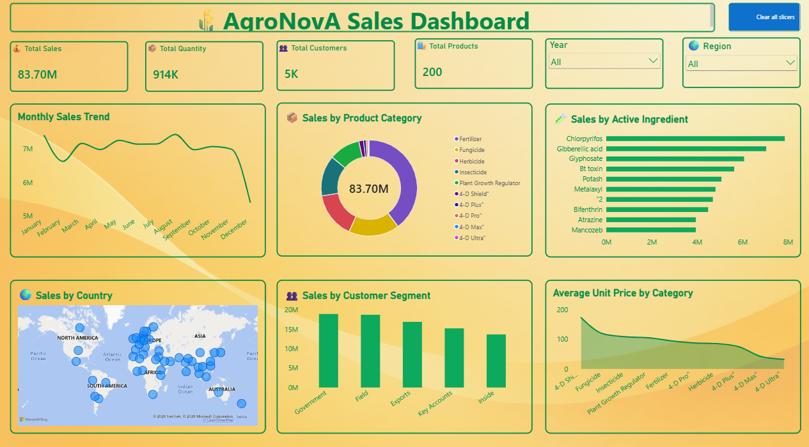
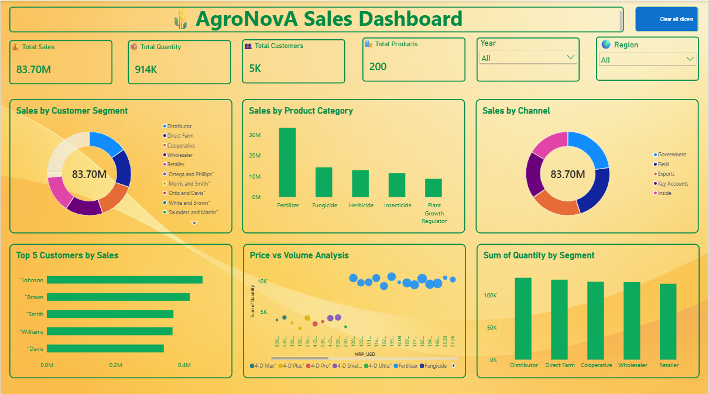
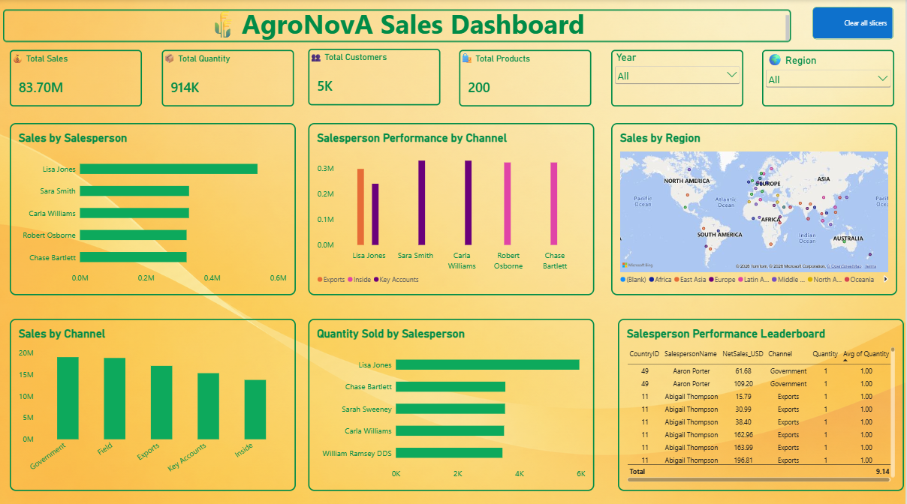
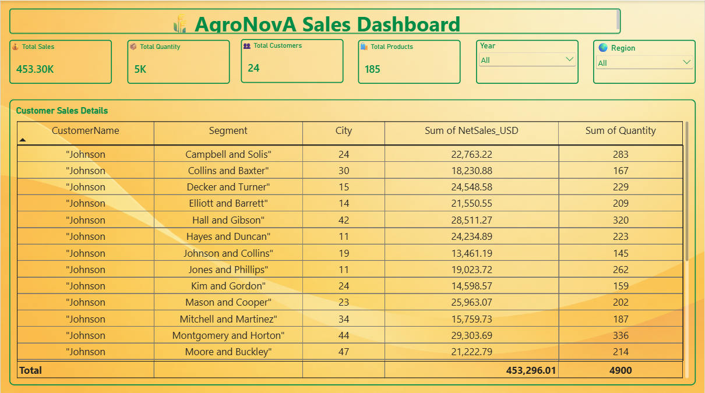

# AgroNovA Data Analysis Project

## Project Overview
This project focuses on analyzing agricultural sales data to generate meaningful business insights.

## Tools Used
- Python (Pandas)
- SQL Server
- Power BI
- Microsoft Excel

## Project Process
- Data cleaning and preprocessing using Python
- Data storage and analysis using SQL Server
- Interactive dashboard creation using Power BI

## Dashboard Preview

### Page 1

### Page 2

### Page 3

### Page 4

